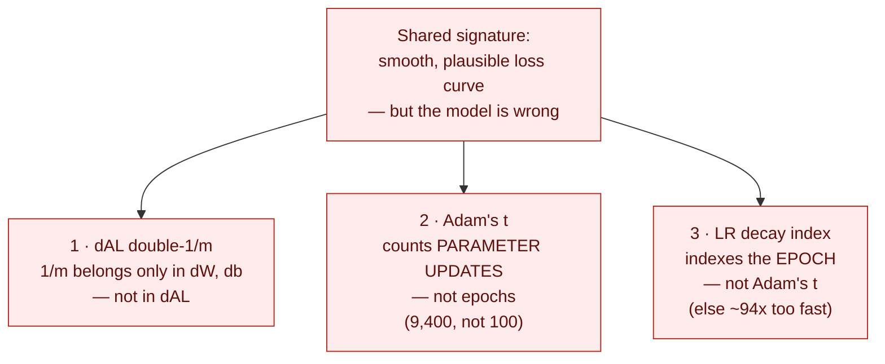

# Model A — Full Pipeline and Optimization History

**From-scratch feedforward network (NumPy, manual backprop) for inverse kinematics of a 3R arm in 3D.**

> **Provenance.** The numbers and section references below reflect `master` @ `27442dd` (`thesis_doc.md` §2, §3.7–3.12, §4–4.4). This file currently sits on the `brainstorming` branch, whose own `thesis_doc.md` and `CLAUDE.md` are the older **v5-era** snapshot and stop before Adam — if they appear to contradict this page, they are the stale copies.

---

## 1. The pipeline

```mermaid
flowchart LR

  subgraph P0["0 · Problem & Data"]
    direction TB
    A0["Robot definition<br>L1=1.0, L2=1.0, L3=0.5"]
    A1["Sample joint angles<br>uniformly in limits"]
    A2["Forward kinematics<br><code>forward_kinematics</code>"]
    A2e["$$r = L_1 + L_2\cos\theta_2 + L_3\cos(\theta_2+\theta_3)$$"]
    A2f["$$z = L_2\sin\theta_2 + L_3\sin(\theta_2+\theta_3)$$"]
    A3["Encode<br><code>encode_theta1_sincos</code><br><code>encode_elbow_config</code>"]
    A4["Split 80/10/10<br>standardize on train stats"]
    A0 --> A1 --> A2 --> A2e --> A2f --> A3 --> A4
  end

  subgraph P1["1 · Initialization"]
    direction TB
    B0["<code>initialize_parameters</code>"]
    B1["He init<br>$$W^{[l]} \sim \mathcal{N}\left(0, \tfrac{2}{n^{[l-1]}}\right)$$"]
    B2["Layers [4, 256, 128, 64, 4]<br>seed = 1"]
    B0 --> B1 --> B2
  end

  subgraph P2["2 · Forward propagation"]
    direction TB
    C0["<code>linear_activation_forward</code><br><code>forward_propagation</code>"]
    C1["$$A^{[l]} = g\left(W^{[l]}A^{[l-1]} + b^{[l]}\right)$$"]
    C2["ReLU hidden · linear output<br>out = [sin θ1, cos θ1, θ2, θ3]"]
    C0 --> C1 --> C2
  end

  subgraph P3["3 · Cost"]
    direction TB
    D0["<code>compute_cost</code>"]
    D1["$$J = \frac{1}{2m}\left\lVert A^{[L]} - Y \right\rVert_F^2$$"]
    D2["MSE on normalized targets"]
    D0 --> D1 --> D2
  end

  subgraph P4["4 · Backward propagation"]
    direction TB
    E0["$$dA^{[L]} = A^{[L]} - Y$$"]
    E1["no 1/m here — see gotcha 1"]
    E2["<code>linear_activation_backward</code><br>$$dW^{[l]} = \tfrac{1}{m} dZ^{[l]} A^{[l-1]T}$$"]
    E3["<code>backward_propagation</code><br>1/m lives only in dW, db"]
    E0 --> E1 --> E2 --> E3
  end

  subgraph P5["5 · Parameter update"]
    direction TB
    F0{"<code>optimizer</code>"}
    F1["<code>update_parameters</code><br>plain GD (v0–v5)"]
    F1e["$$W := W - \alpha\, dW$$"]
    F2["<code>update_parameters_with_adam</code><br>v6"]
    F2e["$$W := W - \alpha \frac{\hat v}{\sqrt{\hat s} + \epsilon}$$"]
    F3["<code>update_lr</code> · <code>schedule_lr_decay</code><br>v7"]
    F3e["$$\alpha_t = \frac{\alpha_0}{1 + \text{decay rate} \cdot t}$$"]
    F0 -->|gd| F1 --> F1e
    F0 -->|adam| F2 --> F2e
    F2e --> F3 --> F3e
  end

  subgraph P6["6 · Final model (merged)"]
    direction TB
    G0["<code>nn_model</code>"]
    G1["per epoch: decay α<br>indexed by EPOCH"]
    G2["<code>random_mini_batches</code><br>batch 256 · 94 per epoch"]
    G3["inner <code>_step</code> owns t<br>t = global UPDATE counter<br>9,400 over 100 epochs"]
    G0 --> G1 --> G2 --> G3
  end

  subgraph P7["7 · Inference & evaluation"]
    direction TB
    H0["<code>predict_ik</code><br>query at elbow_config = +1 and −1"]
    H1["decode θ1 via atan2"]
    H2["pick by min FK reprojection<br>$$\hat\theta = \arg\min_{\theta} \left\lVert \mathrm{FK}(\theta) - (x,y,z) \right\rVert_2$$"]
    H3["<code>evaluate</code><br>circular <code>mae_degrees</code><br><code>pose_error_mm</code><br>elbow-selection accuracy"]
    H4["<code>log_run_metrics</code><br>→ model_a_training_log.csv"]
    H0 --> H1 --> H2 --> H3 --> H4
  end

  A4 --> B0
  B2 --> C0
  C2 --> D0
  D2 --> E0
  E3 --> F0
  F1e --> G0
  F3e --> G0
  G3 -.->|next mini-batch / epoch| C0
  G3 --> H0
  A2 -.->|same FK reused| H2

  classDef data fill:#e8f0fb,stroke:#1f4e9c,stroke-width:1px,color:#0d2b52
  classDef train fill:#e4f4f2,stroke:#137a70,stroke-width:1px,color:#0b3f3a
  classDef eval fill:#f3ecfa,stroke:#5b3a8e,stroke-width:1px,color:#2e1c50
  classDef warn fill:#fdeaea,stroke:#b3261e,stroke-width:1px,color:#5c110d

  class A0,A1,A2,A2e,A2f,A3,A4 data
  class B0,B1,B2,C0,C1,C2,D0,D1,D2,E0,E2,E3,F0,F1,F1e,F2,F2e,F3,F3e,G0,G1,G2,G3 train
  class H0,H1,H2,H3,H4 eval
  class E1 warn
```

---

## 2. Optimization history (v0 → v8)

Each node carries the change and the resulting **test-set end-effector pose error**.

```mermaid
flowchart LR
  V0["v0 · dAL double-divided by m<br><b>3230 mm</b>"]
  V1["v1 · bug fixed, raw angles<br><b>528 mm</b>"]
  V2["v2 · sin/cos encoding for θ1<br><b>194 mm</b>"]
  V3["v3 · elbow_config input<br>+ best-of-2 at inference<br><b>101.6 mm</b>"]
  V4["v4 · capacity [4,256,128,64,4]<br><b>74.1 mm</b>"]
  V5["v5 · mini-batch GD, batch 256<br><b>48.9 mm</b>"]
  V6["v6 · Adam, α = 3e-4<br><b>31.6 mm</b>"]
  V7["v7 · LR-decay sweep<br>NULL RESULT — no rate beat<br>no decay, so v7 = v6<br><b>31.6 mm</b>"]
  V8["v8 · decay + larger α0<br>α0 = 2e-3 → ~3e-4<br><b>22.6 mm</b>"]

  V0 --> V1 --> V2 --> V3 --> V4 --> V5 --> V6 --> V7
  V7 -.->|"§4.3's mechanism predicted<br>decay needs a larger α0"| V8

  classDef bug fill:#fdeaea,stroke:#b3261e,stroke-width:1px,color:#5c110d
  classDef step fill:#e8f0fb,stroke:#1f4e9c,stroke-width:1px,color:#0d2b52
  classDef null fill:#f2f2f2,stroke:#8a8a8a,stroke-width:1px,stroke-dasharray:4 3,color:#3d3d3d
  classDef best fill:#e4f4f2,stroke:#137a70,stroke-width:2px,color:#0b3f3a

  class V0 bug
  class V1,V2,V3,V4,V5,V6 step
  class V7 null
  class V8 best
```

**v7 is drawn dashed and grey deliberately.** It is an honest null result, not an improvement — every decay rate tested made pose error *worse*, because v6's α₀ = 3e-4 was already the smallest rate in the §4.2 sweep and not in the "bouncing near the minimum" regime decay is meant to fix. That negative result is what motivated v8's hypothesis, so it earns its place in the chain (`thesis_doc.md` §4.3 → §4.4).

---

## 3. Optimizations, in detail

| # | Optimization | What it does | Why it was added | §  |
|---|---|---|---|---|
| 1 | **`dAL` fix** | Top-level gradient is $dA^{[L]} = A^{[L]} - Y$, with `1/m` applied only inside `dW`/`db` | v0 applied `1/m` twice, silencing gradients by a further factor of $m$ | §3.5 |
| 2 | **sin/cos encoding for $\theta_1$** | Target becomes $[\sin\theta_1, \cos\theta_1, \theta_2, \theta_3]$, decoded with `atan2` | Removes the $\pm\pi$ wraparound discontinuity. $\theta_1$ MAE fell ~10x (15.3° → 1.6°) | §3.7 |
| 3 | **`elbow_config` input** | 4th input $\pm1$ from $\operatorname{sign}(\theta_3)$; at inference, query both and keep the nearer FK reprojection | Resolves the elbow-up/elbow-down one-to-many ambiguity a single deterministic head cannot represent | §3.9 |
| 4 | **Capacity increase** | `[4,64,64,4]` → `[4,256,128,64,4]` | Lowers the general regression precision ceiling identified by the §4.1 singularity diagnostic | §4 |
| 5 | **Mini-batch GD** | `random_mini_batches`, batch 256, 100 epochs | ~94x more parameter updates per epoch — both faster *and* more accurate, not a trade | §3.10 |
| 6 | **Adam** | Momentum ($v$) + RMSprop ($s$) + bias correction, fused | Largest single win: 48.9 → 31.6 mm (−35%) at an identical epoch budget | §3.11 |
| 7 | **LR decay** | $\alpha_t = \alpha_0 / (1 + \text{decay rate}\cdot t)$, inverse-time or staircase | Shrinks the *global* step over time — orthogonal to Adam's *per-parameter* adaptation | §3.12 |
| 8 | **Decay + larger $\alpha_0$** | $\alpha_0 = 2\times10^{-3}$ decaying to $\approx3\times10^{-4}$ by epoch 99 | Only useful when $\alpha_0$ starts *above* the best fixed rate. Best result in the project: 22.6 mm | §4.4 |

### Two findings worth carrying into the write-up

- **Cost and pose error rank models differently.** In the §4.2 sweep the *lowest-cost* run ($\alpha=3\times10^{-3}$, $J=0.002673$) had **worse** pose error, angle MAE, and branch selection than the selected run ($J=0.003168$, 31.61 mm). Selecting on training cost would have picked a measurably worse model by the thesis's own criterion.
- **Elbow-selection accuracy is floored at ~57%, and no optimizer moves it.** It stayed flat from v3 through v8. This is a metric-framing artifact of scoring an intrinsically one-to-many problem against one sampled label — not a modelling defect (§4, v2→v3 interpretation).

---

## 4. Three gotchas, one failure signature

All three train **smoothly and plausibly** while being wrong. None fails loudly. That shared signature is why they belong on a methodology figure rather than buried in prose.

Gotchas 2 and 3 are trivially swappable — both counters are live in the same training loop. `nn_model`'s final print line reports both the parameter-update count and $\alpha_0 \to \alpha_{\text{final}}$ so each is checkable at a glance.
